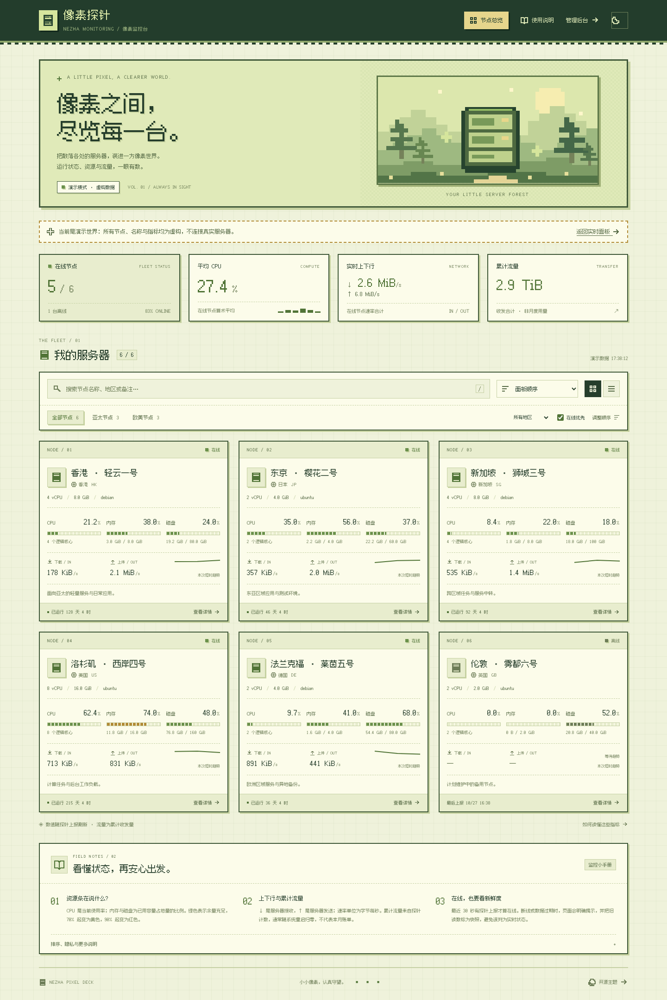
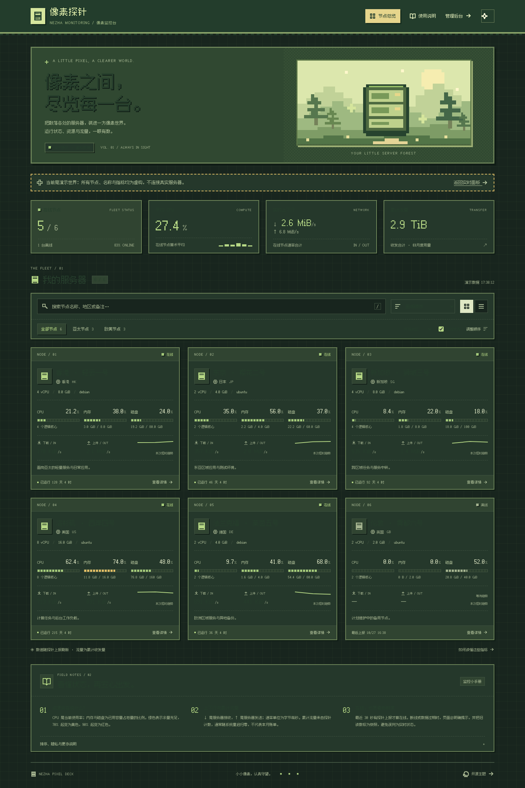

# Nezha Pixel Deck

给哪吒监控 v2 的一方像素世界。森林绿、奶油色、中文像素字体、分段资源条与手绘 SVG 风景，把服务器状态做成一张清楚的小卡片。

**纯静态 · 同源实时数据 · 无第三方统计 · MIT 开源**



## 有什么

- 深度像素界面：本地中文像素字体、硬边框、方块图标、像素森林和深浅色主题。
- 实时状态：在线数、CPU、内存、磁盘、收发速率、累计流量、运行时间。
- 灵活排序：后台权重、名称、地区、CPU、内存、累计流量、运行时间、自定义前移 / 后移；支持在线优先。
- 搜索与筛选：名称、地区、备注全文搜索，后台分组与地区筛选，卡片 / 紧凑视图。
- 节点详情：硬件、负载、连接数与本次会话短时趋势；自动重连、失效提示和缺失数据状态。
- 详细说明：内置指标手册，明确流量口径、在线判定、排序和隐私边界。
- 轻量实现：TypeScript + Vite，不依赖 UI 框架、图表库或外部 CDN。

## 先看演示

需要 Node.js 22.12+，推荐 Node.js 24。

```sh
npm ci
npm run dev
```

打开 `http://127.0.0.1:5173/?demo=1`。演示模式完全使用虚构数据，不连接真实哪吒、不读取你的站点配置。公开截图也是由这个模式生成的。

| 浅色像素 | 深色像素 |
| --- | --- |
|  |  |

## 安装到哪吒

已验证 Dashboard v2.4.1 默认用户模板，保留原管理后台和 Agent。

```sh
npm ci
npm run build
sudo python3 scripts/install.py --dashboard-dir /opt/nezha/dashboard --dist dist
```

实际工作目录和模板设置需与你的部署一致。安装器只安装静态主题，提供旧版本备份和回滚记录。**完整步骤、容器挂载、代理、定制与回滚见 [部署文档](docs/deployment.md)。**

可在部署机器创建 `config.local.json`，设置站点标题、默认顺序、别名和节点说明；示例见 [config.example.json](public/config.example.json)。该文件是公开文件，只放允许访客看到的信息。

## 关于开源与隐私

仓库只包含通用主题、示例配置和虚构节点。没有生产域名、服务器地址、真实节点、数据库、部署凭据或生产截图。字体与风景资源随站点本地加载，没有第三方统计。前端不内置 API Token；访问权限由原哪吒后端控制。

默认不展示旧主题 JSON 备注中的账单字段；已经存在于后端公开接口的信息，仍需在后台移除或限制访问。详见 [安全说明](SECURITY.md)。

## 开发与检查

```sh
npm test
npm run build
npx playwright install chromium
npm run test:e2e
npm run check:privacy
```

GitHub Actions 自动执行构建、逻辑测试、浏览器测试和内容检查，并提供 `dist` 下载。已覆盖排序、持久化、真实接口帧结构、备注转义、断线提示和手机布局。

## 许可与致谢

主题代码与原创 SVG 为 [MIT](LICENSE)。[Fusion Pixel](https://github.com/TakWolf/fusion-pixel-font) 字体使用 SIL OFL 1.1；字体及其上游许可证保存在 [public/fonts](public/fonts/)。本项目是独立的社区前端，使用 [哪吒](https://github.com/nezhahq/nezha) 的公开 v2 接口，与官方项目不存在隶属关系。
